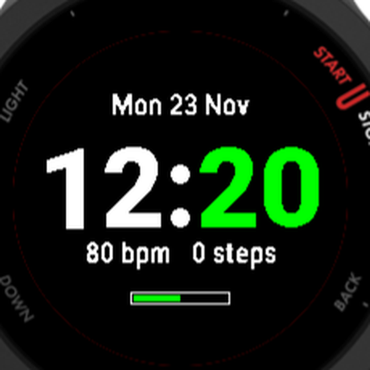
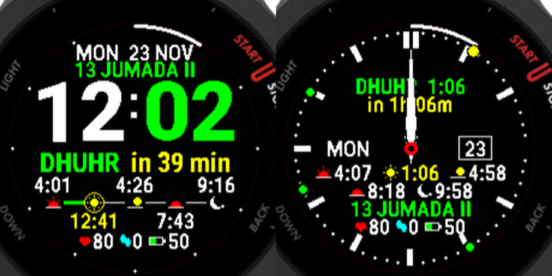

# Garmin Watch Face Skill for AI coding agents

Describe the watch face you want; your AI agent designs it, builds it, checks it in the Garmin
simulator and installs it on your watch over USB.

Works with **Claude Code, OpenCode, Hermes Agent, Codex** and any agent that can read a
`SKILL.md` or `AGENTS.md` file and run shell commands.




## What you get

- `skills/garmin-watchface/SKILL.md`: the step-by-step workflow the agent follows.
- `scripts/`: helper scripts the agent runs.
  - `device_info.py`: screen size, colours, fonts and memory for your watch.
  - `new_face.sh`: start a face from the template, with a fresh app id.
  - `build.sh`: compile the face for one watch.
  - `sim.sh`: run it in the simulator and take a screenshot (Linux, macOS, Windows via WSL).
  - `sideload.sh`: copy it to a USB-connected watch and verify the copy.
- `template/`: a working digital face: clock, date, heart rate, steps, battery, on-watch settings.
- `references/`: device compatibility, plus a list of problems already solved.
- `examples/prayer-watchface/`: a complete project with two faces (digital timeline + analog).
  It has Islamic prayer times, Hijri date, GPS location, on-watch settings, and an Arabic mode.

## Prerequisites

| Need | Notes |
|---|---|
| Garmin **Connect IQ SDK Manager** | Download from developer.garmin.com/connect-iq/sdk. Install the latest SDK (tested with 9.3.0). |
| **Device profile** for your watch | In the SDK Manager > Devices, download your watch. Profiles are not in the SDK zip. |
| **Java 17+** (JDK) | The compiler and simulator run on Java (`java -version`). |
| **Developer key** | One-off: `openssl genrsa -out k.pem 4096 && openssl pkcs8 -topk8 -inform PEM -outform DER -in k.pem -out ~/.Garmin/ConnectIQ/developer_key.der -nocrypt && rm k.pem`. Never share it. |
| **Python 3** | For the scripts. The Arabic font tool also needs `pillow` and `arabic-reshaper` (`uv` or `pip`). |
| An **AI coding agent** | Claude Code, OpenCode, Hermes, Codex, or similar. |
| **USB cable** for the watch | To sideload. |
| Windows users | Use **WSL** (Ubuntu) for the agent and scripts, and install the SDK on Windows as well. `sim.sh` drives the Windows simulator from WSL. |

## Watch compatibility

Any Garmin watch that runs **Connect IQ** can use these faces. That includes Forerunner, fenix,
epix, Enduro, Instinct, Venu, vivoactive, MARQ, Descent and Approach models; check that your
model is listed in the SDK Manager. Fitness bands (vivosmart, vivofit) and Lily are not supported.

- **MIP screens** (Forerunner 55/255/955, fenix 6/7): 8 or 64 colours, no greys. The skill
  knows to use colour instead.
- **AMOLED screens** (Forerunner 265/965, Venu, epix): full colour, plus burn-in limits in always-on mode.
- **Sideloading**: watches that mount as a USB drive (e.g. Forerunner 55/245) are handled by
  `sideload.sh`. Newer MTP watches (fenix 7+, Venu 2+, FR 255+): copy the `.prg` into
  `GARMIN/Apps` with Explorer or OpenMTP.

The examples were built and tested on a **Forerunner 55**. Details:
[skills/garmin-watchface/references/devices.md](skills/garmin-watchface/references/devices.md).

## Install the skill

```bash
git clone <this repo> garmin-watchface-skill
cd garmin-watchface-skill
./install.sh          # or ./install.sh --link to keep it in sync with git pull
```

`install.sh` copies the skill into each agent's skills folder that exists on your machine:

| Agent | Folder |
|---|---|
| Claude Code | `~/.claude/skills/garmin-watchface` |
| OpenCode | `~/.config/opencode/skills/garmin-watchface` |
| Hermes Agent | `~/.hermes/skills/garmin-watchface` |
| Codex CLI | `~/.codex/skills/garmin-watchface` |
| Others | `~/.agents/skills/garmin-watchface`, or open this repo and the agent reads `AGENTS.md` |

## Use it

Open your agent and ask, for example:

> Make me a Garmin watch face for my Forerunner 55: big time, date, steps and battery, with a
> blue accent. Show me a simulator screenshot, then install it on my watch.

The agent then:
1. reads your watch's limits;
2. starts from the template;
3. builds and screenshots in a loop until the layout is clean;
4. copies the face to your watch.

On the watch: unplug, hold **UP** > **Watch Face** > pick your face. Options you add appear
under the face's **Customize/Settings** entry on the watch.

You can also run the scripts yourself:

```bash
S=skills/garmin-watchface/scripts
$S/device_info.py --list
$S/new_face.sh ~/myface "My Face" fr55
$S/build.sh ~/myface fr55
$S/sim.sh ~/myface/bin/fr55.prg fr55 shot.png
$S/sideload.sh ~/myface/bin/fr55.prg MYFACE.PRG
```

## Example: prayer-times faces

`examples/prayer-watchface` builds two faces from one codebase:

```bash
cd examples/prayer-watchface && ./build.sh
```

See its [README](examples/prayer-watchface/README.md).

## Licence

MIT. The bundled Noto Sans Arabic font is under the SIL Open Font License 1.1.
Garmin, Connect IQ and the watch names are trademarks of Garmin Ltd.; this project is not
affiliated with Garmin.
