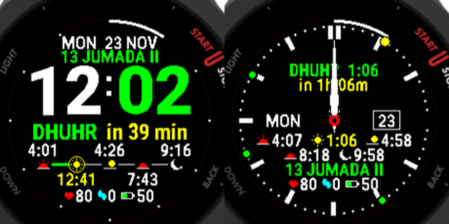
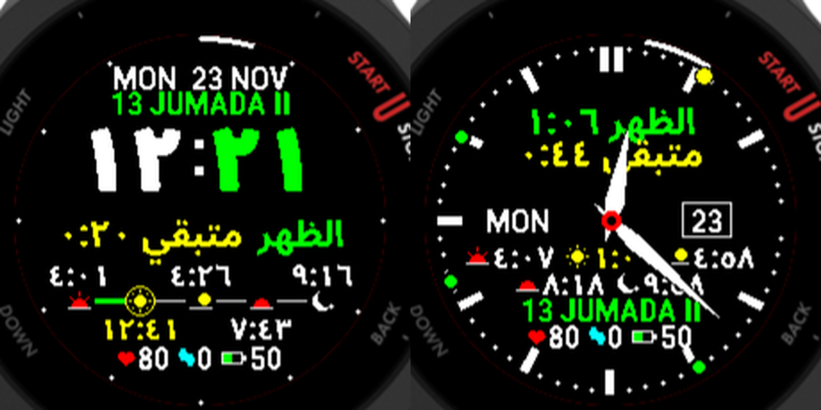

# Prayer Times watch faces (example)

Two Connect IQ watch faces built from one codebase, made for the Garmin **Forerunner 55**
(208x208, 8-colour MIP).




| Face | Build file | Look |
|---|---|---|
| Prayer Times | `monkey.jungle` | Big two-colour clock, next prayer with countdown, timeline of the five prayers. |
| Prayer Classic | `monkey-analog.jungle` | Analog dress-watch dial with hands; the bezel arc shows time left in the current prayer. |

## Features
- **Prayers:** Fajr, Dhuhr, Asr, Maghrib and Isha.
  - Calculated on the watch, with the Muslim World League method by default.
  - Asr can be Shafi'i or Hanafi.
  - Asr can be shifted -10 to +20 minutes to match a mosque timetable.
- **Edge dial:** shows how much of the current prayer time is left. It turns yellow under
  60 minutes and red under 30.
- **Hijri date:** uses the Umm al-Qura table for 1446-1460 AH, falling back to the tabular
  calendar outside that range. It can be shifted ±2 days for local moon sighting.
- **Location:** taken from the watch's last GPS fix, from any activity. Defaults to Melbourne.
- **Arabic mode:** Arabic digits, prayer names and the "متبقي" (time left) line.
- **Health data:** heart rate with an all-day fallback, steps and battery.
- **Settings:** all options are on the watch, under Watch Face > this face > Customize/Settings.

## Build and install

```bash
./build.sh                                    # bin/prayer-times-fr55.iq and bin/prayer-classic-fr55.iq
S=../../skills/garmin-watchface/scripts
$S/build.sh . fr55                            # bin/fr55.prg (digital)
$S/build.sh . fr55 monkey-analog.jungle       # analog; rename before building the other one
$S/sideload.sh bin/fr55.prg PRAYTIME.PRG
```

Each face has its own app id, so both can be installed at once. Before publishing your own
fork, give both manifests new ids.

## Arabic fonts

`tools/make_arabic_fonts.py` rebuilds `resources/fonts/*` and `source/ArabicText.mc` from Noto
Sans Arabic Bold (`tools/fonts`, SIL OFL):

```bash
uv run --no-project --with pillow --with arabic-reshaper python tools/make_arabic_fonts.py
```

## Code map
| File | Job |
|---|---|
| `source/PrayerCalc.mc` | Sun position and prayer times. |
| `source/PrayerView.mc` | Drawing for all designs (ring, list, timeline, analog), Hijri calendar, location pickup. |
| `source/PrayerApp.mc` | Settings and location storage. |
| `source/PrayerDelegate.mc` | On-watch settings menu. |
| `source/digital/Design.mc`, `source/analog/Design.mc` | Pick the layout per face. |
